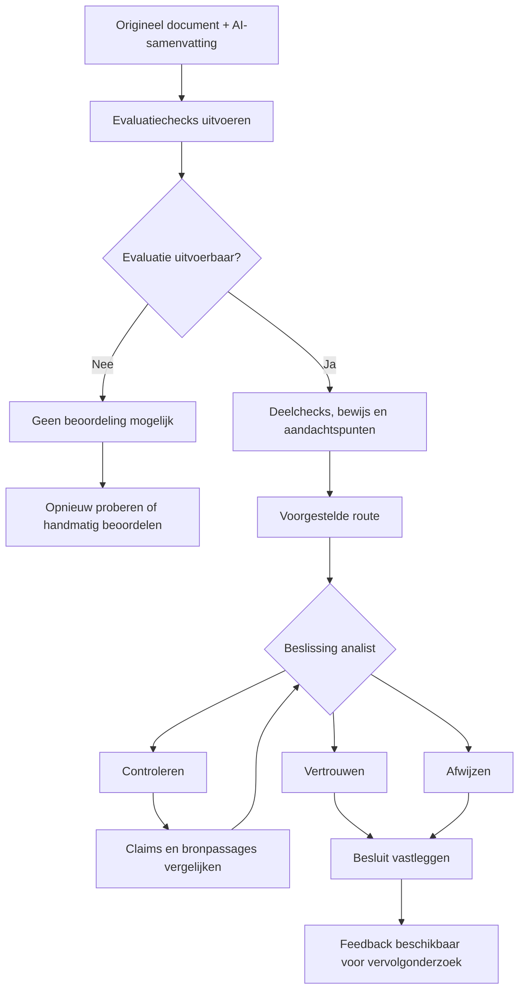

# 03. Design patterns voor SummaryCheck

**Documenttype:** ontwerpverkenning en patroonselectie  
**Datum:** 23 november 2026  
**Status:** concept, nog te onderbouwen en empirisch te toetsen

## 1. Doel

Design patterns bieden mogelijke oplossingsrichtingen voor terugkerende interactieproblemen bij AI-systemen. In SummaryCheck draait de interactie om onzekerheid, interpretatie van evaluatie-uitkomsten en de verdeling van verantwoordelijkheid tussen systeem en analist.

De aangeleverde terminologie verwijst naar **PAIR-gerelateerde patronen** en naar het cursusmateriaal over uitvoervormen en gebruikersflows. Exacte bronverwijzingen, formele patternnamen en de toepasbaarheid daarvan moeten in een volgende literatuurstap worden geverifieerd. De onderstaande tabel documenteert **ontwerpinterpretaties**, niet aangetoonde effecten.

## 2. Eerste patroonselectie

| Patroon / principe | Voorgestelde verwerking | Te adresseren probleem | Toetsidee |
|---|---|---|---|
| Verwachtingen duidelijk maken | Bij iedere check een korte beschrijving van wat wel/niet is onderzocht; geen garantieclaim | Overschatting van evaluatiecapaciteit | Laat gebruikers uitleggen wat 'geen aandachtspunten' betekent |
| Uitleg voor begrip | Per waarschuwing een claim, mogelijke fout, motivering en relevante bronpassage | Onbegrijpelijke scores en moeizame verificatie | Meet begrip en tijd tot bronverificatie |
| Vertrouwen zorgvuldig tonen | Deelchecks en tekstlabels zoals 'geen aandachtspunt', 'controle nodig', 'onvoldoende bewijs', niet uitsluitend één percentage | Schijnprecisie en automation bias | Vergelijk interpretatie bij totaalpercentage versus onderbouwde deelchecks |
| Gebruikersfeedback mogelijk maken | Markeren als juist, onjuist of onvolledig, eventueel met toelichting | Geen correctiekanaal of terugkoppeling | Observeer of foutmeldingen juist en volledig kunnen worden ingediend |
| Automatisering laten bewaken | Systeem doet routevoorstel; analist kan afwijken met reden | Onvoldoende menselijke controle | Meet of gebruikers een foutieve aanbeveling kunnen overrulen |

## 3. Aanvullende patronen in de reviewflow

### 3.1 Zorgvuldige afweging tussen precision en recall

**Ontwerpprobleem:** een foutdetectie-instelling kan te veel onterechte waarschuwingen genereren of materiële fouten missen.

**Concept:** de engineer ziet per geannoteerde testset het effect van vooraf gedefinieerde detectiedrempels op precision, recall, false positives, false negatives en het aantal waarschuwingen. De instelling kan pas zinvol worden gekozen nadat de kosten van gemiste en onterecht gemarkeerde fouten zijn besproken.

**Voorgestelde UI:** een instelbaar controleprofiel met zichtbaar resultaat vóór toepassing. Een slider is hooguit een interactieconcept; de keuze wordt gekoppeld aan werkelijk gemeten testuitkomsten, niet aan een arbitraire visuele schaal.

**Toetsvraag:** wordt begrepen dat hogere gevoeligheid een andere foutverdeling kan veroorzaken, en worden de resultaten correct geïnterpreteerd?

### 3.2 Verantwoordelijkheid nemen voor fouten

**Ontwerpprobleem:** zonder terugmeldmogelijkheid kan een fout onopgemerkt blijven in het evaluatie- en verbeterproces.

**Concept:** een laagdrempelige actie **Meld een probleem**, met classificatie van het type fout, optionele toelichting en zichtbare bevestiging. Het concept kan een feedbackregistratie voor nadere beoordeling door de engineer bevatten.

**Voorgestelde UI:** knop bij de betreffende claim/check, selecteerbare foutcategorieën en een bevestiging van ontvangst. Een melding wordt pas als opgelost weergegeven na daadwerkelijke afhandeling.

**Toetsvraag:** kunnen gebruikers de fout melden en begrijpen zij wat de melding wel en niet automatisch verandert?

### 3.3 Controle teruggeven bij mislukte automatisering

**Ontwerpprobleem:** een mislukte evaluatie zou ten onrechte als positief resultaat kunnen worden gezien.

**Concept:** een afzonderlijke toestand **Geen beoordeling mogelijk** met toelichting en vervolgstappen: **Open brondocument**, **Opnieuw proberen** en **Handmatig beoordelen**.

**Toetsvraag:** herkennen gebruikers dat er géén kwaliteitsuitspraak beschikbaar is en kiezen zij een passende vervolgstap?

## 4. Inpassing in de user flow

### Patrooninzet per fase

| Fase | Prioritaire patronen |
|---|---|
| Introductie en start | Verwachtingen duidelijk maken |
| Evaluatieresultaat | Vertrouwen zorgvuldig tonen; uitleg voor begrip |
| Onderbouwing | Bronverwijzing en markering van relevante passages |
| Besluit | Automatisering bewaken, mogelijkheid om advies te overrulen |
| Foutmelding | Verantwoordelijkheid nemen voor fouten |
| Evaluatiefalen | Controle teruggeven aan gebruiker |
| Engineeranalyse | Precision/recall-afweging, vergelijkbare metrics en foutfeedback |

## 5. Hypothesen en risico's

- **H1:** onderbouwde waarschuwingen leiden tot beter begrip van specifieke fouten dan niet-toegelichte scores.
- **H2:** een goed zichtbare onbekend/foutstatus vermindert het aantal onterechte acceptaties van niet-geëvalueerde samenvattingen.
- **H3:** bronverwijzingen verkorten de benodigde tijd om een bepaalde claim te controleren.
- **H4:** een automatische route kan beslissingen ondersteunen, maar kan ook *automation bias* oproepen; daarom moeten afwijkingen van het systeemadvies mogelijk blijven.

Deze verwachtingen worden niet als feiten gepresenteerd. Hun toetsing staat in [05-Validatieplan](05-Validatieplan.md).

## 6. Bronnenstatus

**Aangeleverde input:** ontwerp- en cursusmateriaal met PAIR-patroonlabels, uitvoervormen en oefening 'patterns in your flow' (23 november 2026). Dit document bevat nog geen geverifieerde primaire literatuurverwijzingen. Formele bronvermelding wordt toegevoegd zodra titel, auteurs, editie en URL/publicatiedatum van de oorspronkelijke patternbibliotheek zijn gecontroleerd.

[Terug naar ontwerpindex](README.md)
