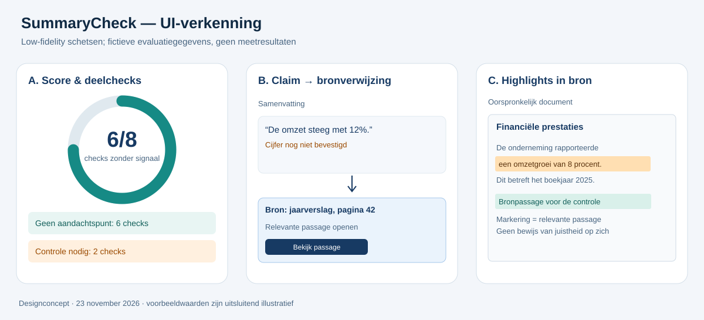
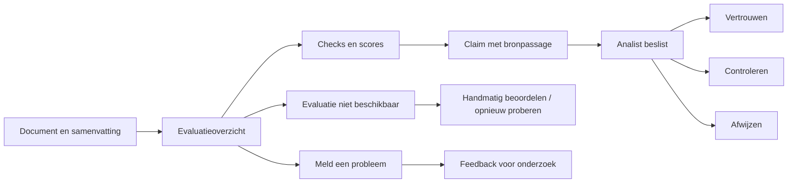

# 04. UI-concept en interactieontwerp — SummaryCheck

**Documenttype:** exploratief interactieconcept / low-fidelity specificatie  
**Datum:** 23 november 2026  
**Status:** brainstorm; visuele keuzes en routes moeten worden getest

## 1. Ontwerpdoel

SummaryCheck presenteert geautomatiseerde evaluatie-uitkomsten zo dat een analist de kwaliteit van een AI-samenvatting gericht kan onderzoeken en een eindbeslissing kan nemen. Voor de AI-engineer is een afzonderlijke, analytische interface voorzien waarin evaluatiechecks, modelversies en afwijkende casussen worden vergeleken.

Centrale ontwerpgedachte: **een routevoorstel ondersteunt de beslissing, maar vervangt deze niet**.

## 2. Visuele informatievormen

De aangeleverde lesdia onderscheidt onder meer tekst, tabellen, grafieken, beelden, interactieve output, antwoorden met bronnen, scores/labels/confidence, annotaties, documenten en acties. Voor SummaryCheck lijken vooral de volgende vormen relevant:

| Presentatievorm | Conceptuele toepassing |
|---|---|
| Scores, labels en confidence | Statusoverzicht en afzonderlijke checkuitkomsten |
| Antwoorden met bronnen en bewijs | Koppeling tussen claim en originele passage |
| Highlights en annotaties | Visualisatie van relevante of betwiste brontekst |
| Tabellen en grafieken | Vergelijking van evaluatieresultaten tussen modelversies |
| Interactieve output | Openklapbare checks, filters en navigatie |
| Acties | Vertrouwen, controleren, afwijzen, terugmelden |
| Documenten | Oorspronkelijke bron en samenvatting naast elkaar |

## 3. UI-keuzes: drie alternatieven

### Variant A — Circulaire score-indicator

**Voorstel:** een gedeeltelijk gevulde ring met een getal in het midden en een expliciet label van wat het getal betekent, bijvoorbeeld '6 van 8 checks zonder aandachtspunt'. De ring is een aggregatie van checkuitkomsten, niet een bewezen waarschijnlijkheid dat de samenvatting correct is.

**Mogelijk voordeel:** compacte weergave en snelle visuele oriëntatie. **Risico:** een groot percentage kan schijnzekerheid oproepen.

**Te vergelijken met:** een lijst met afzonderlijke checks zonder ring.

### Variant B — Bronverwijzing per claim

**Voorstel:** een aanklikbare koppeling tussen een zin in de samenvatting en een passage in het brondocument, met paginanummer of sectienaam indien beschikbaar.

**Mogelijk voordeel:** directe verifieerbaarheid. **Risico:** de gevonden passage kan verwant maar onvoldoende bewijskrachtig zijn; de interface moet dat onderscheid toelichten.

### Variant C — Gemarkeerde passages in het origineel

**Voorstel:** markeringen tonen welke bronpassages bij een claim of evaluatiecheck zijn gebruikt. Verschillende markeringen kunnen bijvoorbeeld staan voor 'relevant bewijs', 'tegenstrijdige informatie' of 'niet gevonden'.

**Mogelijk voordeel:** expliciete documentcontext. **Risico:** veel highlights kunnen de leesbaarheid verminderen en gemarkeerde tekst kan ten onrechte als betrouwbaar bewijs worden beschouwd.

Deze varianten kunnen gecombineerd worden. De keuze welke combinatie geschikt is, volgt pas na gebruikerstesten.

## 4. Kleurgebruik en toegankelijkheid

| Kleurrol | Conceptuele betekenis | Vereist tekstlabel |
|---|---|---|
| Donkerblauw | Navigatie en neutrale hoofdacties | Actienaam |
| Oranje | Aandachtspunt of nader onderzoek | Controle nodig |
| Rood | Materiële afwijking of niet-onderbouwde claim | Belangrijk punt niet onderbouwd |
| Groenblauw | Uitgevoerde controles vonden geen aandachtspunten | Geen aandachtspunten gevonden |
| Neutraal grijs | Onbekend, niet uitgevoerd of ontbrekende evaluatie | Geen beoordeling mogelijk / niet beoordeeld |

Kleur wordt nooit als enige drager van betekenis gebruikt: tekst, iconen, duidelijke focusindicatoren en voldoende contrast zijn nodig. Een positieve checkuitkomst betekent uitsluitend dat **de betreffende controle** geen probleem heeft aangetoond.

## 5. Scherm voor de analist

### 5.1 Header en status

**Voorbeeldinhoud (fictief):**

> **Jaarverslag 2025 — Samenvatting**  
> Evaluatie afgerond · 8 controles uitgevoerd

Een statuscomponent benoemt de uitkomst met een toelichting. Mogelijke toestanden:

| Visuele status | Bericht | Mogelijke vervolgstap |
|---|---|---|
| Groenblauw | **Geen aandachtspunten gevonden.** De uitgevoerde controles hebben geen probleem gesignaleerd; dit garandeert geen foutloze samenvatting. | Controleer kritieke claims, besluit zelf |
| Oranje | **Controle nodig.** Twee onderdelen lijken mogelijk af te wijken van het document. | Bekijk aandachtspunten |
| Rood | **Belangrijk punt niet onderbouwd.** Een materiële claim kon niet worden bevestigd. | Open bronpassage en beoordeel |
| Neutraal/oranje | **Geen beoordeling mogelijk.** De vergelijking met de bron is niet afgerond. | Opnieuw proberen of handmatig beoordelen |

De getallen in de voorbeelden zijn fictief en dienen alleen om de interactie te beschrijven.

### 5.2 Checkdetail en traceerbaarheid

Voorbeeld van een uitklapbare kaart:

> **Mogelijk niet onderbouwde claim**  
> Samenvatting: “De omzet steeg met 12%.”  
> Bevinding: voor dit percentage is in de geselecteerde bronpassages geen bevestiging gevonden.  
> **Bekijk passage in document**

Het detail toont idealiter de exacte claim, het soort bevinding, de betreffende bronlocatie, de beperkingen van de check en een link naar het originele document. **Geen bewijs gevonden** is niet automatisch hetzelfde als **feitelijk onjuist**.

### 5.3 Menselijke beslissing

Drie duidelijk herkenbare acties:

- **Vertrouwen** — donkerblauw gevuld; legt acceptatie door de analist vast.
- **Controleren** — oranje omlijnd; opent of markeert benodigde verdere beoordeling.
- **Afwijzen** — rood omlijnd; registreert dat de samenvatting in de huidige vorm ongeschikt is.

Knopprioriteit moet afhangen van de taakstatus: het ontwerp mag niet standaard richting 'Vertrouwen' sturen wanneer er onopgeloste ernstige signalen zijn. De gevolgen van een actie en de mogelijkheid tot correctie moeten duidelijk zijn.

Voorbeeldbevestiging:

> **Samenvatting gemarkeerd als 'Controleren'.** Bekijk de aandachtspunten of open het brondocument.

### 5.4 Foutmelding door analist

Kleine aanvullende actie: **Meld een probleem**.

Voorlopige categorieën: **Feit klopt niet**, **Belangrijke informatie ontbreekt**, **Claim is niet onderbouwd**, **Anders**. Een optioneel tekstveld geeft context.

Voorbeeldbevestiging:

> **Melding ontvangen.** Deze melding is vastgelegd voor verdere beoordeling.

Het scherm mag geen daadwerkelijke opvolging beloven zolang die niet is ingericht.

## 6. Scherm voor de AI-engineer

### 6.1 Vergelijking van modelversies

Filtermogelijkheden: modelversie (bijvoorbeeld v1/v2), documenttype, dataset en evaluatiecheck. De engineer ziet zowel geaggregeerde scores als afzonderlijke fouten, inclusief de noemer van ieder resultaat. Vergelijkingen gebruiken dezelfde dataset en dezelfde evaluatieregels voor beide modelversies.

### 6.2 Instelling van foutdetectie

Conceptuele UI:

> **Hoe streng moet de controle zijn?**  
> Een gevoeligere controle kan meer potentiële fouten signaleren, maar ook meer onterechte waarschuwingen opleveren.

Een slider met de uiteinden **Minder onterechte meldingen** en **Minder gemiste fouten** kan dit spanningsveld illustreren. In een werkend systeem mag deze slider alleen concrete, gevalideerde instellingen of drempels aanpassen. Zonder empirische testwaarden is de slider een schets, geen uitgewerkte beslisregel.

**Actie:** Voorbeeldresultaten bekijken — toont aantallen TP, FP, FN en eventueel TN, plus precision en recall, wanneer beschikbaar.

### 6.3 Analystfeedback verwerken

Voorbeeldkaart:

> **Nieuwe melding — Jaarverslag 2025**  
> Type: Belangrijke informatie ontbreekt  
> Modelversie: v2  
> **Bekijk melding** · **Markeer als beoordeeld**

De status 'beoordeeld' staat niet gelijk aan 'opgelost'. Een daadwerkelijke feedbackworkflow vereist registratie, verantwoordelijkheid, triage en opvolging.

## 7. Faal- en geen-antwoord-scenario

Wanneer het systeem geen bruikbare evaluatie kan uitvoeren:

> **Geen beoordeling mogelijk**  
> De samenvatting kon niet voldoende met het oorspronkelijke document worden vergeleken. Er is daarom geen automatische kwaliteitsuitspraak beschikbaar.

**Acties:** Open het brondocument · Opnieuw proberen · Handmatig beoordelen.

Het systeem toont geen positieve beoordeling wanneer evaluatiegegevens ontbreken. De interface maakt onderscheid tussen een **negatieve controle-uitkomst**, **onvoldoende bewijs** en **technisch mislukte evaluatie**.

## 8. Schematische schermflow

## 9. Vervolgvragen

- Begrijpen analisten een ringmeter correct of interpreteren zij die als objectieve betrouwbaarheid?
- Welke statuswoorden zijn het minst dubbelzinnig?
- Welke informatie is nodig om een bronpassage werkelijk als bewijs te kunnen beoordelen?
- Is het wenselijk om een primaire knop visueel te benadrukken voordat de analist het bronbewijs heeft bekeken?
- Hoe kan de engineer kwaliteitsverschillen tussen versies interpreteren zonder misleidende aggregatie?

Deze vragen worden uitgewerkt in [05-Validatieplan](05-Validatieplan.md).

[Terug naar ontwerpindex](README.md)
